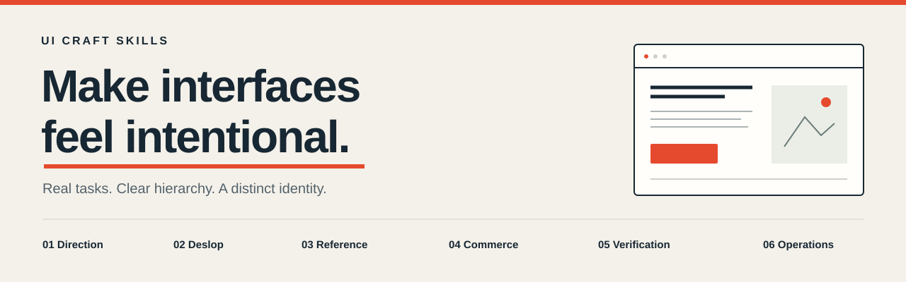

<p align="center">
  
</p>

# UI Craft Skills

**Make interfaces feel intentional.** Six practical skills for designing distinctive websites and apps, cleaning up generic UI, and verifying the result.

[English](README.md) · [Azərbaycanca](README.az.md) · [Prompt examples](docs/examples.md) · [Contributing](CONTRIBUTING.md) · [MIT license](LICENSE)

Built for Codex's `SKILL.md` format. The instructions are readable Markdown and can be adapted to other coding agents; no cross-agent integration is claimed.

## A better design brief, not another visual template

AI-generated interfaces often repeat the same decisions: oversized heroes, interchangeable card grids, vague copy and decorative effects competing for attention. Removing those effects alone does not make a good product.

These skills start with the user, the actual task, the brand and real content. They preserve deliberate visual identity, improve the flow, and ask for evidence from the rendered interface.

**A gradient is not automatically slop. Neither is purple, Inter, a rounded card or an animation.** The question is whether the choice helps this product and the person using it.

## Choose the skill that fits

| Skill | Use it when… | Focus |
| --- | --- | --- |
| [`product-ui-direction`](skills/product-ui-direction/SKILL.md) | You are designing a new interface or making a substantial redesign. | Brand, task, composition, real content and a convincing first slice. |
| [`ui-deslop`](skills/ui-deslop/SKILL.md) | The interface feels generic, cluttered or visually disconnected from the product. | Specific diagnosis and coherent cleanup without erasing identity. |
| [`reference-led-web-design`](skills/reference-led-web-design/SKILL.md) | You have a website, screenshot or approved mockup to follow. | Observable reference fidelity, page families and matching renders. |
| [`commerce-ux-refinement`](skills/commerce-ux-refinement/SKILL.md) | Product choice, variants, checkout or account screens are confusing. | Accurate offers, clear selections and usable customer flows. |
| [`responsive-ui-verification`](skills/responsive-ui-verification/SKILL.md) | A UI change needs checking or has broken an existing layout. | Comparable renders, real task states, locales and input methods. |
| [`operational-dashboard-ux`](skills/operational-dashboard-ux/SKILL.md) | Operators struggle with filters, work lists or progress. | Useful density, correct subsets and truthful status. |

Start with the main task. Load a second skill only when its guidance is useful; there is no need to run all six for a button edit.

## Install

Requires **Python 3.10+** and Git. Installing and using the bundled helper scripts needs no Python packages, MCP server or API key. Your coding agent's own requirements still apply.

```bash
git clone https://github.com/samigiman/ui-craft-skills.git
cd ui-craft-skills

# Preview what will be installed.
python3 scripts/install.py --all --dry-run

# Install all six into your Codex skills directory.
python3 scripts/install.py --all
```

Install only one skill instead:

```bash
python3 scripts/install.py --skill ui-deslop
```

The destination defaults to `$CODEX_HOME/skills` when `CODEX_HOME` is set, otherwise `~/.codex/skills`. Use `--dest /path/to/skills` for another location. Existing skill folders are never overwritten; a conflicting selection stops before installation.

Start a new Codex turn after installation so the skills can be discovered. You can also copy an individual folder from `skills/` manually. The installer only copies files; it does not edit agent configuration or enable plugins.

## Use

```text
$ui-deslop
Clean up this interface's generic visual patterns. Keep the brand color,
real content and working flows. Show the important before/after differences.
```

```text
$reference-led-web-design
Build the complete site from this reference. Compare the first viewport
and a representative internal page at matching mobile and desktop widths.
```

```text
$responsive-ui-verification
Check this content edit for visual regressions. Preserve the existing
composition and verify the relevant navigation and validation states.
```

See [more examples](docs/examples.md) for new products, commerce and dashboards, including review-only requests.

## A source-triage helper, not an AI detector

`ui-deslop` includes a small, read-only Python scanner:

```bash
python3 skills/ui-deslop/scripts/scan_ui_candidates.py ./your-frontend --limit 50
```

It points to possible effects, animation loops, gradient text, blanket transitions and overflow masking for inspection. It skips common dependency/build folders, bounds its work, and leaves source files unchanged. Every result is a **candidate**; the tool deliberately returns no design-quality verdict or AI-origin score. Even zero candidates does not establish a good interface.

## What this collection promises

- A focused decision process instead of one prescribed aesthetic.
- The user's chosen brand, references and scope take priority.
- Useful content, truthful states and working flows remain central.
- Reviews stay read-only; fixes stay within the requested scope.
- Code checks, visual verification and client acceptance stay distinct.

These are instructions, not a theme, component library or automatic redesign engine. Outcomes depend on the agent, project and available preview. If a browser or device cannot be checked, the skill calls for an explicit evidence limit.

## Development

```bash
# Structural validation needs PyYAML; installation and runtime helpers do not.
python3 -m pip install -r requirements-dev.txt
python3 scripts/validate.py
python3 -m unittest discover -s tests -v
```

The checks cover package structure, metadata, references, source-triage behavior and safe installation. They do not prove that an agent will produce good design. See [validation limits](docs/validation.md).

Contributions with a concrete UI problem, reproducible example and a focused improvement are welcome. Please omit private client data from issues and pull requests.

Created by [Samig Imanov](https://github.com/samigiman). Released under the [MIT License](LICENSE).
